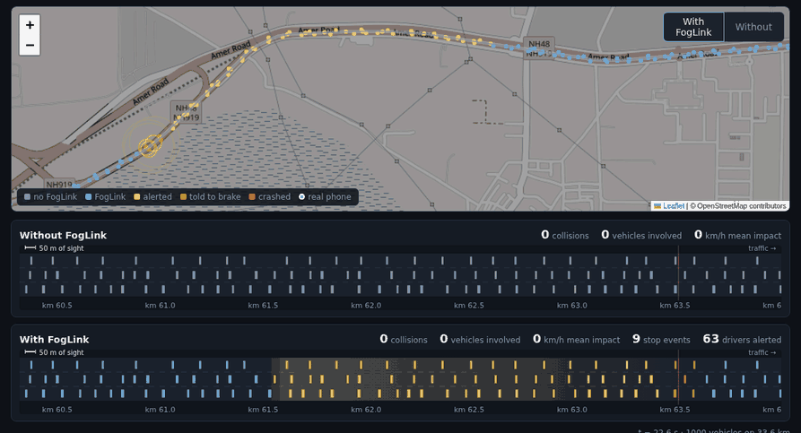
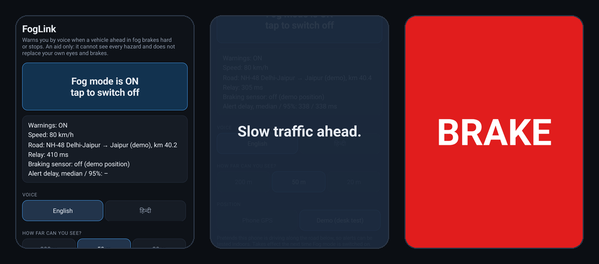
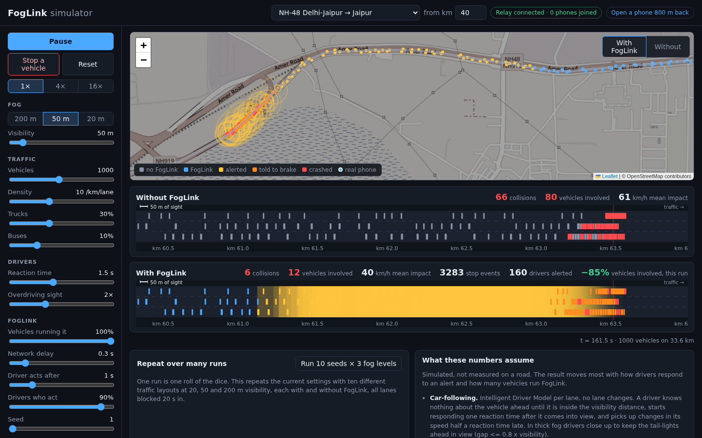
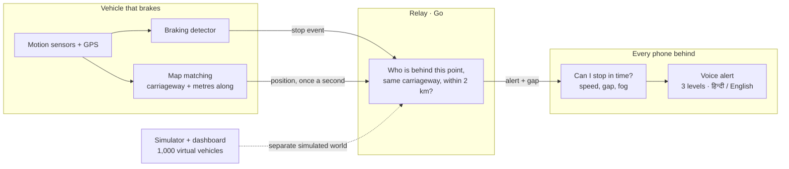

<div align="center">

# FogLink

**A fog-time collision warning network built from the phones already in cars.**

When a vehicle brakes hard or stops on a foggy expressway, every phone behind it on
the same carriageway, up to 2 km back, speaks a warning in Hindi or English.

[](https://github.com/beastb728/FogLink/actions/workflows/ci.yml)
[](https://github.com/beastb728/FogLink/actions/workflows/relay-health.yml)
[](https://github.com/beastb728/FogLink/releases/latest)
[](LICENSE)


### [▶ Live demo](https://foglink-relay.fly.dev) &nbsp;·&nbsp; [⬇ Download the Android app](https://github.com/beastb728/FogLink/releases/latest/download/FogLink.apk) &nbsp;·&nbsp; [How it works](#how-it-works)



<sub>Same traffic, same blockage, 50 m visibility. Top strip: no FogLink. Bottom strip: every vehicle running it. Yellow is the warning travelling back.</sub>

</div>

---

## Why

Every winter, fog on north Indian expressways causes chain collisions: a vehicle
stops, and drivers behind see it only when it is too late to stop. The information
that would help them, "something has stopped 600 m ahead of you", exists the moment
the first driver brakes. FogLink carries it backward faster than the traffic arrives.

It needs no roadside hardware and no new device: a phone on the dashboard is the
sensor, the radio and the loudspeaker.

> FogLink is an assistive warning. It cannot see every hazard and it does not
> prevent crashes. It is never a reason to drive faster in fog.

## Try it in 60 seconds

1. Open the **[live dashboard](https://foglink-relay.fly.dev)**. It simulates 1,000 vehicles on the real NH-48 Delhi–Jaipur line.
2. Press **Start**, then **Stop a vehicle**. Watch the two strips diverge.
3. Press **Open a phone 800 m back** and tap **Fog mode** on the page that opens. That page is a real client of the real relay. Turn the sound on: it speaks as the virtual traffic ahead of it brakes.
4. Press **Run 10 seeds × 3 fog levels** for averages over many traffic layouts.

## The app

<div align="center">

</div>

One screen and one button. The driver taps **Fog mode** before setting off and does
not touch the phone again; everything after that is spoken.

| | |
|---|---|
| **Three alert levels** | "Slow traffic ahead" → "Vehicle stopped 300 metres ahead" → **BRAKE**, chosen from the deceleration this driver would need to stop in time |
| **Hindi and English** | Voice, tone and vibration; a red full-screen flash for BRAKE |
| **Says when it cannot warn** | "FogLink offline. No network." Silence is never allowed to mean "all clear" |
| **Works with the screen off** | Foreground service; comes back by itself if Android kills it |
| **No account** | No name, no phone number, no login. A random ID that changes every 10 minutes |
| **220 KB** | Release build, shrunk with R8 |

**[Download the APK](https://github.com/beastb728/FogLink/releases/latest/download/FogLink.apk)** (Android 8+), or see [android/README.md](android/README.md) to build it.

## The simulator

<div align="center">

</div>

The dashboard answers the question a phone alone cannot: *what happens to a whole
road?* It runs two copies of identical traffic, one with FogLink and one without,
and lets you change the fog, the traffic mix, how drivers behave and what share of
vehicles run the app. Every result is shown beside the assumptions that produced it.

## How it works



- **A carriageway is a line.** One direction of one road, stored in the direction traffic drives. A position is just metres along it, so "behind" means "smaller number, same carriageway". Phones do the map matching; the relay never sees raw GPS.
- **The relay only routes.** It holds one latest position per anonymous ID for five seconds, in memory, and writes nothing to disk.
- **Phones decide whether to speak.** One alert rule, [`sim/src/core/alert.js`](sim/src/core/alert.js), is shared by the web client, the simulator and (ported to Kotlin) the Android app.

### Alert levels

The phone works out the deceleration its driver would need to stop short of the
reported position, after a 1.5 s reaction time and a fog margin of 10 to 40 m.

| Level | Deceleration needed | Spoken |
|---|---|---|
| Heads-up | under 1 m/s² | "Slow traffic ahead." / "आगे ट्रैफ़िक धीमा है।" |
| Warning | 1 to 3 m/s² | "Vehicle stopped 300 metres ahead." / "300 मीटर आगे गाड़ी रुकी है।" |
| Critical | over 3 m/s² | "BRAKE" / "ब्रेक!" with a red full-screen flash and vibration |

## Engineering highlights

- **One rule, three runtimes, verified equal.** The alert rule, map matching, braking detector and status logic are written once in JavaScript and ported to Kotlin. A generator replays about 5,000 alert cases, 240 map-matching cases and a 65-second sensor stream through the reference, and the Android unit tests require the port to match exactly.
- **Simulated and real traffic cannot mix.** The public dashboard and any phone showing a demo position live in a separate world inside the relay. A click on the demo can never make a phone in a real car speak.
- **Fake events are refused.** With no accounts there is nobody to ban, so the relay checks the physics instead: a stop event is forwarded only if its sender has been reporting a consistent drive on that carriageway, at road speed, at that place.
- **Private by construction.** The server never receives GPS coordinates, keeps no history, and cannot link one ten-minute ID to the next.
- **Orientation-free braking detection.** The phone can lie any way up: gravity gives "down", and speed changes from GPS teach it which way is "forward". It fires on 0.35 g sustained for 200 ms, and ignores speed breakers and being picked up.
- **Real roads.** Both carriageways of NH-48 Delhi–Jaipur (247 km) and the Yamuna Expressway (179 km), built from OpenStreetMap by a routing pass that follows one-way geometry, with toll plazas marked so that toll queues do not trigger alerts.
- **A traffic model that crashes for the right reasons.** Intelligent Driver Model with limited sight distance, reaction delay and drivers who overdrive their visibility. With no incident it produces zero collisions at every fog level.
- **Operations.** Graceful restarts that tell phones to reconnect, a protocol version handshake, CI on every push, and an end-to-end probe of the live relay every 15 minutes.

## Results

| What | Result | Measured on |
|---|---|---|
| Relay fan-out to 1,000 phones | 14 ms at the 95th percentile (32 ms with Redis) | One machine, loopback |
| Event to alert through the live relay | 323 ms median, 381 ms worst of 10 | Home broadband in India ↔ relay in Singapore, both hops |
| Braking detection, 1D-CNN (8,241 parameters, 36 KB) | 92.8% precision, 98.7% recall | Synthetic drives, 75 held-out episodes |
| Braking detection, threshold rule (shipped in the app) | 93.8% precision, 94.7% recall | Same |
| False alarms | 3.7 per 100 km (threshold), 6.3 (CNN); target is under 1 | Synthetic drives with speed breakers, potholes and toll stops |
| Android app | Alerts spoken over Wi-Fi and mobile data | OnePlus 11R, demo position, stationary |

<details>
<summary><b>Simulated pileups, with and without FogLink</b> (20 traffic layouts per row)</summary>

<br>

All lanes blocked 20 s into the run; 1,000 vehicles, 3 lanes, 10 vehicles per km per
lane; 240 s each. "Vehicles involved" is every vehicle that hit or was hit.

| Visibility | Vehicles running FogLink | Vehicles involved, without → with | Fewer | Mean impact speed km/h, without → with |
|---|---|---|---|---|
| 20 m | 10% | 97.8 → 96.8 | 1% | 46 → 46 |
| 20 m | 30% | 97.8 → 84.1 | 14% | 46 → 43 |
| 20 m | 50% | 97.8 → 67.3 | 31% | 46 → 41 |
| 20 m | 100% | 97.8 → 17.4 | 82% | 46 → 24 |
| 50 m | 10% | 121.9 → 114.3 | 6% | 59 → 58 |
| 50 m | 30% | 121.9 → 88.3 | 28% | 59 → 53 |
| 50 m | 50% | 121.9 → 61.5 | 50% | 59 → 48 |
| 50 m | 100% | 121.9 → 11.2 | 91% | 59 → 32 |
| 200 m | any | 0 → 0 | – | – |

FogLink did worse than no FogLink in 0 of the 20 runs in every row. Reproduce with `make ab`.

**These numbers describe the model, not the road.** The benefit is roughly
proportional to adoption, and at 10% it is close to nothing, which is why a rollout
would start with fleets. The assumptions:

- **Car-following.** Intelligent Driver Model per lane, no lane changes. A driver knows nothing about the vehicle ahead until it is within sight, responds one reaction time (mean 1.5 s) later, and in thick fog closes up to keep tail-lights in view.
- **Speed in fog.** Drivers pick a speed whose stopping distance is twice what they can see. At 200 m this never bites and nobody crashes.
- **Braking.** Wet road: cars 6.5, buses 4.8, trucks 4.2 m/s².
- **Detection.** A phone reports hard braking, a crash or crawling after 0.2 s, catching 95% of events.
- **Relay.** Events reach every equipped vehicle up to 2 km behind after 0.3 s, with no coverage gaps.
- **Driver response.** 90% of alerted drivers, one second after the alert, ease down to a speed they can stop from within what they can see.
- **Not modelled.** Lane changes, swerving, secondary impacts, alert fatigue.

</details>

<details>
<summary><b>Wire protocol</b></summary>

<br>

JSON over one WebSocket at `/ws?p=1` (add `&world=sim` for simulated traffic).

| Direction | Message |
|---|---|
| phone → relay, every second | `{"t":"pos","id","cw","s","v","ts"}` |
| phone → relay, on an event | `{"t":"stop","id","cw","s","v","dec","kind","ts"}`, kind `brake`, `stopped`, `slow` or `crash` |
| relay → phones behind | `{"t":"alert", …the stop event…, "gap","rts"}` |
| clock sync | `{"t":"ping","ts"}` → `{"t":"pong","ts","rts"}` |
| relay → phone, on connecting | `{"t":"hello","p","min","world"}` |

- **Versions.** Changes within a version are additive; both sides ignore what they do not know. A client older than `min` is closed with code 4426 and tells its driver to update.
- **Plausibility.** A real-world stop event needs three consistent position reports over 2.5 s, road speed within the last 90 s, and a place and speed matching the last report. Refusals are counted at `/stats`.
- **Limits.** 4 stop events and 5 position reports a second per connection; 256 connections per address.
- **Restarts.** On shutdown the relay closes every connection with code 1012; clients reconnect within two seconds and their next position report rebuilds the state.

</details>

## Run it yourself

Needs Docker, Node 22 and Python 3.10+. Go runs inside Docker.

```bash
make up        # relay + Redis + dashboard on http://localhost:8080
make dev       # the same with live reload on http://localhost:5173
make test      # relay and simulator tests
make ab        # the with-vs-without table above
make ml        # train and score the braking model
make apk       # build the Android app
```

To host your own relay, [`fly.toml`](fly.toml) deploys the same Docker image to
Fly.io behind HTTPS: `fly launch --copy-config --no-deploy`, then
`fly deploy --ha=false`. To watch phones that report real positions on the
dashboard, set `FOGLINK_OBSERVER_TOKEN` and open it with `?token=…`; that view is
read-only and off by default.

## What is in the repository

```
android/   Kotlin app: foreground service, sensors, voice alerts; core/ is the ported shared logic
server/    Go relay: routing, in-memory and Redis stores, plausibility checks, health probe
sim/       src/core       alert rule, road geometry, traffic simulator, relay link
           src/dashboard  live map and with-vs-without strips
           src/phone      web phone client and braking detector
ml/        synthetic drives, orientation alignment, GPS auto-labels, 1D-CNN, evaluation
data/      OpenStreetMap pipeline and the carriageway lines it produces
```

**Tests.** Relay: routing by carriageway and distance, ID rotation, expiry, world
separation, refusal of implausible events, versioning, graceful shutdown, fan-out
latency. Simulator: alert levels, no spontaneous collisions, deterministic A/B
arms, map matching, toll zones, the detector against a tilted phone, a speed
breaker and a pick-up. Android: the Kotlin port against the reference vectors.

## Privacy

- No accounts, names or phone numbers.
- IDs are random and replaced every 10 minutes.
- The relay holds a position for 5 seconds and an event only while forwarding it. Nothing is logged or stored.
- Nobody can watch real positions unless the relay operator sets an observer token; that view is read-only.
- Drive recordings stay on the phone.

## Scope and limitations

FogLink 1.0 is a complete, working system: the app, the relay and the simulator
run end to end, and the relay is live. What it has **not** had is a road trial, and
the numbers above say exactly what each one was measured on.

- **Not road-tested.** The app has been exercised on an emulator and on one phone using its built-in demo position. Braking detection, map matching from live GPS, battery drain and audibility in a moving cabin are unmeasured.
- **Braking model.** Trained and scored on synthetic drives only, and its false-alarm rate misses the target. The app ships the simpler threshold detector; the app's drive logger exists to collect real data for the model.
- **Latency headroom.** The live relay is in Singapore. A relay in India would cut the delay.
- **Toll plazas** come from OpenStreetMap and have not been checked on the road.
- **Fake events** are made hard, not impossible: someone who fakes a believable drive first can still send one.
- **One relay instance.** Redis can share positions between instances, but alerts reach only the phones connected to the instance that received the event.
- **Coverage.** Two corridors. No direct phone-to-phone radio for stretches without signal.

## Licence

Code: MIT, see [LICENSE](LICENSE). Road lines and toll plaza positions in
`data/roads/` are derived from OpenStreetMap and remain under the ODbL
(© OpenStreetMap contributors).
